<p align="center">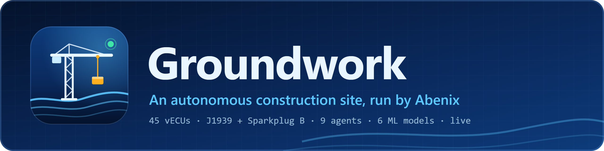</p>

<p align="center">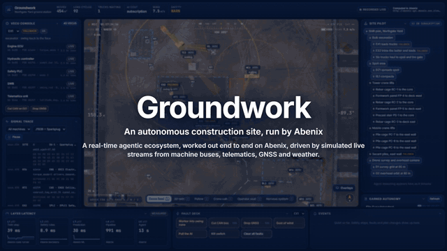</p>

<p align="center"><a href="https://github.com/sarkar4777/groundwork/releases/tag/v1.0.0">Watch the full 64 s films</a>, on the painted site and on a real drone orthophoto, landscape and portrait with subtitles. <a href="https://github.com/sarkar4777/groundwork/releases/tag/v1.1.1">The 2 min industrial PC film</a>, on the real ground, shows the real CAN bus, the closed loop and the PCs in Abenix.</p>

An autonomous construction site, run by [Abenix](https://github.com/sarkar4777/abenix). Northgate Yard is a fictional 4 hectare site digging the two-level basement of a 22-storey tower: two excavators, a dozer, six haul trucks, a luffing tower crane, a mobile crane, a piling rig, a roller, two survey drones and fourteen tagged workers. Every machine has its own virtual controllers talking J1939 on its own bus. Safety rules stop a machine in the same 10 ms tick a worker steps too close. Agents plan the day, a person approves the risky moves, and every number on screen is measured.

> The AI plans in seconds. The safety layer reacts in milliseconds. Abenix runs both, and you can watch every layer do its job.

Groundwork is a showcase, not certified safety software. Do not use it to run real machines.

**Contents:** [What is simulated](#what-is-simulated-and-how-to-swap-in-the-real-thing) · [How the drone feed is made](#how-the-drone-feed-is-made) · [Industrial PCs and the CAN bus](#industrial-pcs-and-the-can-bus) · [Run it end to end](#run-it-end-to-end) · [Use it](#use-it) · [When something is wrong](#when-something-is-wrong) · [How it fits together](#how-it-fits-together) · [Inside Abenix](#inside-abenix) · [Honest notes](#honest-notes) · [Measured](#measured)

## What is simulated, and how to swap in the real thing

| Part | In Groundwork | The real thing |
|---|---|---|
| Drone imagery | Two grounds: a painted site from CC0 aerial textures, or a real drone orthophoto of a live excavation (CC BY 4.0). Both rendered live in the browser with lens, grain and a flight HUD | A live drone stream, an orthomosaic or a reconstruction of your own flight. Only the web's ground layer changes, every overlay reads the same site frame |
| Machine signals | 45 virtual ECUs run remotely inside Abenix as the code asset `gw-site-twin`, standing in for the industrial PCs on each machine. They tick at 100 Hz and emit bit-correct J1939 (EEC1, ET1, LFE1, VP, VDS, ETC2, CCVS1, HOURS, DM1 with BAM) and Sparkplug B | Real machines publish the same frames through a CAN or MQTT gateway |
| Telematics, GNSS, weather | Generated by the twin from a fixed seed, so a run can be replayed | ISO 15143-3 (AEMP 2.0) fleet feeds, RTK GNSS, a site weather station |
| Workers | Fourteen tagged workers walking realistic paths | UWB or BLE worker tags |

Everything that decides runs in Abenix whichever side of this table you are on: the safety rules, the ML models, the pipelines, the agents, approvals and the kill switch.

## How the drone feed is made

There is no video source. The drone feed is a live 3D scene rendered in the browser (three.js, WebGL2) and seen through a virtual drone camera, so every frame is drawn from the twin's state in Abenix as it arrives.

- **The camera.** A drone at 30 to 150 m with real lens behaviour: barrel distortion, sharpening, sensor grain and a vignette. The flight HUD reads the drone's own GNSS, battery and gimbal frames from the twin. Story mode flies scripted shots: an eased push-in, near-nadir long-lens tracking, a guided tour across the full ground station and a closing orbit.
- **The machines.** Every machine is built in code from parts, with painted metal, mud, dust and wear, so each boom, stick, bucket, blade, crane slew and hook you see is a joint angle streamed from the twin. Positions arrive 20 times a second and are interpolated to 60 fps.
- **The overlays.** Swing radii, geofences, crane envelopes, haul roads, cut and fill and worker tags are drawn onto the scene like a survey tool, and labels never overlap.
- **The films.** One recorded live run, played back on a virtual clock and rendered frame by frame, so all 60 frames of every second are real. `scripts/record-take.mjs` records, `scripts/capture.mjs` renders.

### Two grounds

| Ground | What it is | How it is lit |
|---|---|---|
| **Northgate** (default) | A fictional site painted from CC0 aerial, facade and roof scans, with a reshaping pit as the excavators dig | A golden-hour sun with haze |
| **NH108** | A real drone orthophoto of a live excavation at 1.5 cm per pixel, by Craig Goodspeed via OpenAerialMap, CC BY 4.0. The machines parked in the photo are retouched out | The sun computed from the photo's capture time and place (253° azimuth, 22° up), so the simulated machines cast shadows in the same direction and at the same darkness as the photo's own |

On the real ground the twin runs a matching layout, `nh108`, so haul roads, the pit and the spoil follow the photographed tracks and no truck crosses a real heap. The photo is flat, so the camera stays steep. Every frame carries a REAL credit for the photo and a SIMULATED label for the machines and people.

<p align="center">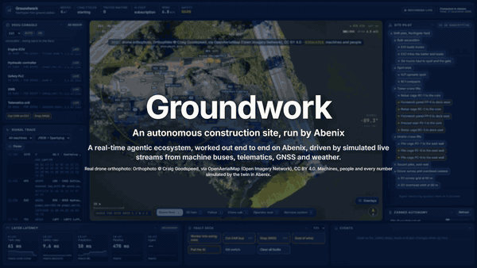</p>

| | |
|---|---|
| 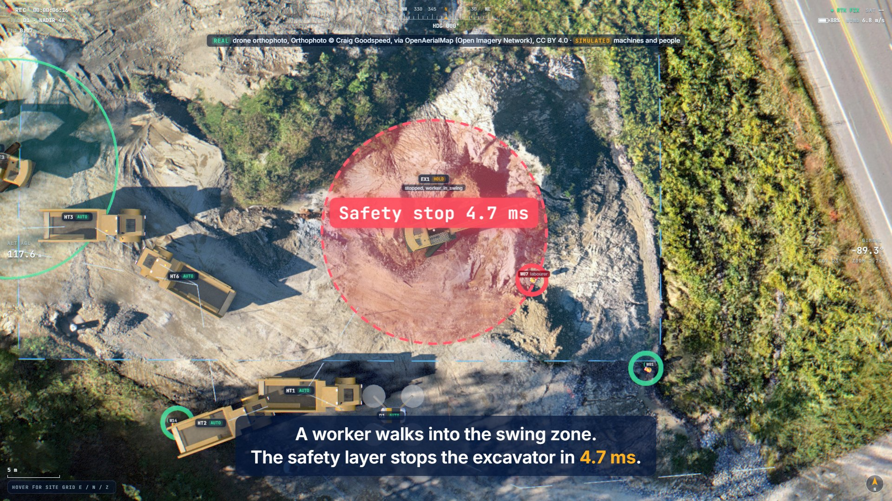 | 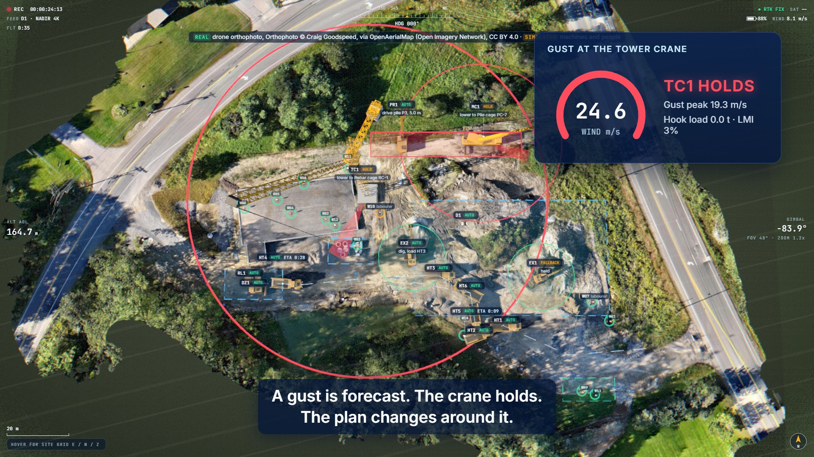 |
| A safety stop on the real excavation | The tower crane holds in a gust |
| 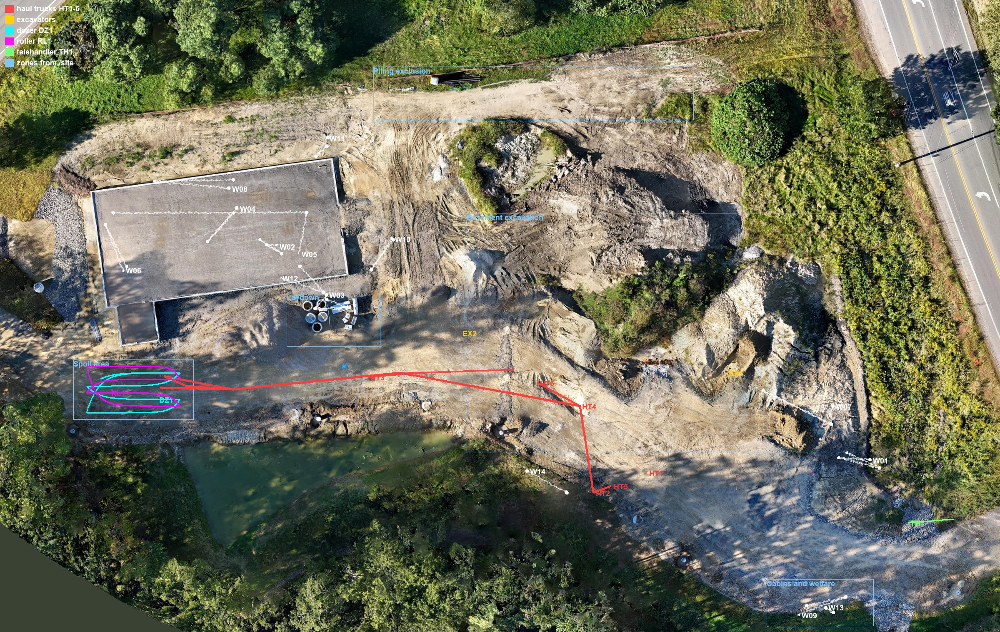 | 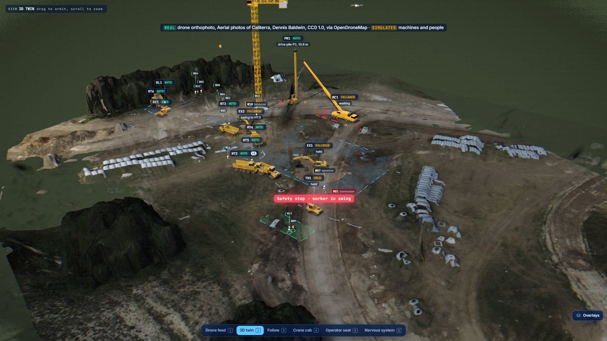 |
| Every truck path over a full story stays on the photographed tracks | Real 3D ground reconstructed from drone photos, with the twin on it |

### Use the real ground

```bash
pip install -r scripts/requirements-real.txt
python scripts/fetch-real-imagery.py        # about 45 MB, checks every file, prepares the tiles in data/real (not in git)
echo "GW_SITE=nh108" >> .env
bash scripts/deploy-k8s.sh                  # or: bash scripts/dev.sh
```

The ground station switches to the real ground by itself when the bff runs the `nh108` site. With the industrial PCs deployed, run `bash scripts/deploy-k8s.sh edge` as well, so they drive the same layout. The twin refuses a PC set up for another one. Then `python scripts/trace_haul.py` and `python scripts/provision.py` once HT1 has driven for 20 minutes, so the geofence follows the new haul road. Remove the line from `.env` and deploy again to go back to Northgate.

### Reconstruct your own site

Drone photos in, a site the machines stand on out. You need Docker for OpenDroneMap. A GPU helps the splat step, through Brush on WebGPU, so no CUDA setup.

```bash
python scripts/reconstruct.py caliterra                     # the CC0 test set, 77 photos
python scripts/reconstruct.py mysite --photos D:/flight     # your own flight
```

It runs OpenDroneMap for the orthophoto, the surface and terrain heights, a textured mesh and the camera poses, levels the result, then trains a Gaussian splat. Open the ground station with `?ground=caliterra&layer=splat` to put the twin on the reconstructed heights. Sources, licences, the sun calculation and what is still open are in [docs/real-imagery.md](docs/real-imagery.md).

## Industrial PCs and the CAN bus

Four machines, EX1, TC1, HT1 and DZ1, also run as simulated industrial PCs in Kubernetes, namespace `groundwork-edge`. Each PC is one pod. Inside it, every ECU on the machine is its own container on one shared CAN bus, and an edge gateway maps the bus to Sparkplug B on the MQTT broker Abenix already runs.

```
 pod ipc-ex1
 ┌──────────────────────────────────────────────────────────────────────────┐
 │ engine  telematics  safety  hydraulics  swing  controller   gateway ─────┼──► MQTT, Sparkplug B
 │    │        │         │         │         │        │           │         │    spBv1.0/groundwork/…
 │    └────────┴─────────┴─────────┴─────────┴────────┴───────────┘         │    groundwork/ipc-ex1/can/raw
 │                 canbus sidecar: vcan0, 250 kbit/s, socketcand            │
 └──────────────────────────────────────────────────────────────────────────┘
```

| What | Real or simulated |
|---|---|
| J1939: 29-bit identifiers, address claim with conflict resolution, Request PGN, TP.BAM and TP.CM RTS/CTS, DM1 with SPN and FMI, TSC1, the repetition rates | Real protocol behaviour, in `edge/ipc/stack.py`. Signals encode with the twin's own J1939 module, so the PCs and the twin speak the same bytes |
| The bus transport | socketcand, the Linux CAN-over-TCP protocol (linux-can/socketcand, rawmode), through python-can |
| The copper and the transceivers | Simulated by the `canbus` sidecar: each frame takes its real bit time at 250 kbit/s, stuff bits and CRC-15 included. Frames serialise one at a time, the lowest identifier wins arbitration, an unacknowledged or corrupted frame becomes an error frame, and every controller's transmit and receive error counters move from error active to error passive to bus off and back |
| The machine | Simulated. Sensors and actuators share the machine through an in-memory volume, the way ECUs share one chassis. Controllers and the gateway only see the bus |
| The gateway, Sparkplug B and MQTT | Real. NBIRTH and DBIRTH per ECU, seq and bdSeq, NDEATH as the MQTT last will, rebirth on NCMD. Signals decode through `edge/dbc/groundwork-j1939.dbc` with cantools |
| Commands from the site | Real J1939 on the bus. `Safety/Hold`, `Mode/Set` and `Diagnostics/InjectFault` arrive as DCMD and go to the safety PLC as proprietary A commands. The PLC acknowledges with ACKM, broadcasts its new state and takes the engine to idle with TSC1, so EEC1 follows. `Task/Assign` goes to the controller as JSON over TP.CM |

No privileged containers, no NET_ADMIN, no kernel modules.

```bash
bash scripts/deploy-k8s.sh edge                 # build the image into minikube, roll out the four PCs
bash scripts/deploy-k8s.sh edge-status
bash scripts/deploy-k8s.sh edge-check 30        # a test pod: rates, births, a hold, a DM1 fault, a noisy harness
bash scripts/deploy-k8s.sh edge-candump EX1     # the bus as candump -L
kubectl -n groundwork-edge exec deploy/ipc-ex1 -c canbus -- candump --decode
kubectl -n groundwork-edge exec deploy/ipc-ex1 -c canbus -- candump --stats
```

Measured on minikube over one 30 s check, about two minutes after the PCs powered on:

| PC | CAN frames/s | Bus load | Arbitration losses | Error frames | MQTT messages/s | Bus queue p50 / p99 |
|---|---|---|---|---|---|---|
| EX1 | 303 | 16.8 % | 351 | 141 | 86 | 0.56 / 1.6 ms |
| TC1 | 393 | 22.1 % | 633 | 912, a noisy harness for 6 s | 80 | 0.57 / 1.7 ms |
| HT1 | 261 | 14.7 % | 359 | 465 | 65 | 0.57 / 1.9 ms |
| DZ1 | 269 | 15.0 % | 169 | 389 | 58 | 0.56 / 1.4 ms |

Error frames on a quiet bus come from power-on, when the first ECU up has nobody to acknowledge it. The noisy harness drove TC1's engine, telematics, slew and hoist controllers to error passive, and they came back to error active within 3 s of the noise stopping.

Hop by hop, EX1: a frame's last bit to the gateway 1.9 ms, gateway to an MQTT subscriber 1.3 ms at the median and 15 ms at p99. A hold sent as DCMD reached the safety PLC's acknowledgement on the bus in 6.5 ms and the excavator's joints read still 206 ms later, braking from a full swing. The hop into Abenix comes with its 2.5.8 telemetry ingest.

Sample logs to open in SavvyCAN or replay with `canplayer`: [edge/samples/ipc-ex1-candump.log](edge/samples/ipc-ex1-candump.log) (power-on address claims, BAM and RTS/CTS sessions, a hold, a DM1 fault) and [edge/samples/ipc-tc1-noisy-harness.log](edge/samples/ipc-tc1-noisy-harness.log) (error frames, error passive and recovery).

### The site runs on the PCs

With the PCs in Abenix (2.5.8 telemetry), the ground station runs a hybrid site. EX1, TC1, HT1 and DZ1 go where their own controllers drive them on their real buses. Every other machine stays in the twin. Each label says which: **IPC · REAL BUS** or **SIM**.

- **The bff only carries data.** It follows the PCs with `forge.telemetry.stream`, polls `forge.telemetry.frames` for the raw CAN frames Abenix keeps, and hands what changed to the twin on each step. It holds no machine logic.
- **The twin decides.** `twin/hybrid.py` in `gw-site-twin` puts the PCs' machines into the site and runs the same safety rules over the whole of it. A Simplex hold goes back as `Safety/Hold` to the PC's safety PLC, fallback as `Mode/Set safe`, a hold in the plan as `Task/Assign`, all through `forge.telemetry.command`. EX1's cycles cut the face and load the simulated trucks, HT1's count on the KPI and TC1's land the queued lifts.
- **The signal trace shows the real bus.** The frames Abenix keeps for each PC decode with the twin's own J1939 dictionary and carry an IPC tag. Filter on *Real bus, IPC* to see only them.
- **Two more faults on the deck.** *Unplug EX1's PC* sends `Node Control/Unplug_s`: the PC drops off MQTT without a goodbye, the broker publishes its NDEATH, Abenix marks it offline and the twin routes around it while EX1's own safety PLC holds it. *Noisy harness on EX1* sends `Bus/InjectNoise_s`: error frames, retransmits and error counters climbing on the wire.
- `GW_IPC=0` keeps every machine simulated. A PC set up for another layout is refused with a message, its machine stays simulated.

<p align="center">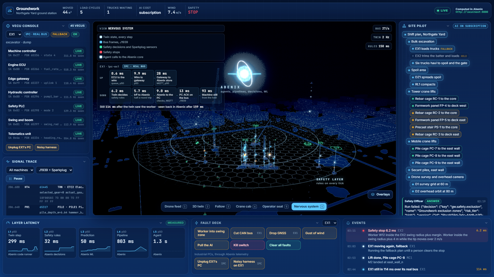</p>

A stop on a PC crosses the network both ways, so its time is the whole chain, each hop on the clock that measured it. From one live take of the industrial PC story:

| Hop | Measured by | ms |
|---|---|---|
| The twin decides, worker inside the swing radius | the twin's safety tick | 4.7 |
| bff to Abenix | half the quickest round trip to the same API | 4.7 |
| Abenix to the PC | Abenix stamps the command on arrival, the gateway on receipt, one cluster clock. Covers Abenix's checks, the publish and the broker | 3.9 |
| The PC to standstill | the gateway, from the hold to joints reading still. The safety PLC's ACK came at 9.2 ms | 148 |
| **Hazard to standstill** | | **162** |

The command API call itself answered in 33 ms, and Abenix showed the PC holding 105 ms after the bff sent the hold. If the machine is already still when the hold arrives there is no stop time, and the screen says *hold in force* with the PC's ACK instead. On the way up, a frame's last bit reaches the gateway in about 2 ms and Abenix stores the gateway's Sparkplug message within 3 to 8 ms at the median.

```bash
curl -X POST localhost:8710/story/start -H 'content-type: application/json' -d '{"ipc": true}'   # the industrial PC story, live
```

**Real hardware is a configuration change.** Every ECU and the gateway read `CAN_INTERFACE`, `CAN_CHANNEL`, `CAN_HOST` and `CAN_PORT`:

| Where the bus is | Set |
|---|---|
| The canbus sidecar (default) | `CAN_INTERFACE=socketcand CAN_HOST=localhost CAN_PORT=29536 CAN_CHANNEL=vcan0` |
| A real socketcand daemon next to a real bus | `CAN_INTERFACE=socketcand CAN_HOST=<daemon host> CAN_PORT=29536 CAN_CHANNEL=can0` |
| An industrial PC with a PEAK or Kvaser USB-CAN adapter | `CAN_INTERFACE=socketcan CAN_CHANNEL=can0`, and drop the sidecar |

With real ECUs on the bus, run only the gateway container. Point `MQTT_URL` at the site broker and set `GW_MACHINE` to the machine it is fitted to.

**The film.** `groundwork-ipc-real-story-1920x1080.mp4` and `-1080x1350.mp4`, 1 min 56 s with subtitles, in the [v1.1.1 release](https://github.com/sarkar4777/groundwork/releases/tag/v1.1.1). It runs on the real NH108 orthophoto with the PCs on the `nh108` layout: the stop over the real bus, every hop, the unplugged PC, the noisy harness, then the closed loop on EX1. The three minute wait for the oil to heat is a title card with the numbers from the take, and from a few seconds before the rule fires everything plays at real speed. Captions sit along the bottom, the clock top left and the cards on the right, one caption at a time. Then the PCs in Abenix. The first cut on the drawn site, with the wait as a time-lapse, is in [v1.1.0](https://github.com/sarkar4777/groundwork/releases/tag/v1.1.0). Screens of the Abenix side are in [docs/screenshots/ipc](docs/screenshots/ipc), named `abenix-*`.

**Backfill through an uplink cut.** The same Abenix stack takes machine data from its Edge gateway too. With the gateway's uplink cut for 123 s, it buffered 7,288 readings at the peak and drained them in under a second when the link came back: 7,449 sent, 0 lost, and 75 of 75 sequence points in order with no gaps or repeats. The truck's engine chart in Abenix shows no hole where the cut was ([abenix-backfill-1440.png](docs/screenshots/ipc/abenix-backfill-1440.png)).

**About the latency numbers.** The hop table above and the loop timings were measured with the site under reduced load. On the laptop with the testbed, the Edge demo and the four PCs all running, the Abenix ingest strip showed p99 ingest delay between 117 and 580 ms, which is the CPU saturating, not the pipeline. A full-scale run is planned on Azure.

### Rules, agents and commands: the closed loop

The PCs' streams drive three signal rules in Abenix. Each rule runs an agent. The agent reads the machine, decides, and acts through a governed command, and the ground station hears every step through the SDK.

| Rule | Watches | Runs | The agent may |
|---|---|---|---|
| EX1 hydraulics running hot | `Hydraulics/OilTemp_C` on EX1, the last 5 min against the half hour before, 15% up | Maintenance tech | set `Mode/Set` to `safe` on a PC's safety PLC, a person approves every time |
| HT1 left the haul road | HT1's site position leaving the ground it works on | Fleet dispatcher | set `Task/Assign` on HT1, the workspace's risk tier decides whether a person approves |
| A PC went offline | any asset tagged `groundwork-ipc`, silent for 45 s, so a restart does not count | Superintendent | read only. It says whether the shift needs a new plan, and the plan still asks a person |

The Safety officer may also ask for a `Safety/Hold`, true only and always approved. The instant stop stays in the twin's 10 ms tick and never waits for an agent.

The rules are in [abenix/rules](abenix/rules). `python scripts/provision.py --only rules` creates them, names and tags the four PCs, and replays each rule on the last 6 hours first. Each was also built once by hand in the rule builder as a check, from the scope picker to the run step.

**Tuned on the streams, not for the demo.**
- The first idea for rule 1 was pump 1 pressure 15% above normal. Replayed on an hour of normal digging, it would have fired on its own: EX1's pump pressure swings from 73 to 181 bar by the minute as it digs, swings and holds. The oil temperature stayed between 54.5 and 60 °C in the same hour, and the rule on it would have fired 0 times in 6 hours.
- HT1's haul area is traced from where the truck really drives: the legs its controller drives with 10 m either side, an 18 m turning pad at the bay, a 14 m margin round the spoil area where trucks swing wide to tip, and 6 m round the positions HT1 reported. A narrow corridor would have fired 22 times an hour, because loaded trucks cut corners. On the real NH108 ground the planned road alone missed the U-turn past the far end of the spoil area and a corner cut back to the bay, so `scripts/trace_haul.py` records HT1's GNSS from Abenix into the twin's `drive.json` and the corridor takes it in. 645 positions from 20 minutes of driving went into the trace, and none of the next 53 fell outside.

**Set them off from the fault deck.**
- *Pump wear on EX1* sends `Diagnostics/InjectFault` 4 to EX1's PC. The main pump works harder for the same flow: pressure creeps up, and the oil heats at about 3 °C a minute. Past 82 °C the hydraulics ECU raises DM1 SPN 1638 FMI 16.
- *Drive HT1 off the road* sends HT1 a route up its own road and 30 m off it, onto open ground clear of every fenced zone.

**In the ground station.** The *Rule → agent → action* panel shows one card per firing: the rule with the signal's last 15 minutes, the agent reading and its answer, then the command waiting for a person, who approved it and when the PC confirmed it. The bff joins this from `forge.events.stream` (`telemetry.rule_fired`, `approval.requested`, `approval.resolved`, `telemetry.command_sent`, `execution.completed`, `telemetry.firing_completed`) and backfills from `forge.telemetry.firings`. It decides nothing.

`Mode/Set` belongs to people and agents. The site holds a PC machine when its rules say so and never sets its mode, so a safe mode on screen always traces back to whoever asked for it, shown on the machine card.

<p align="center">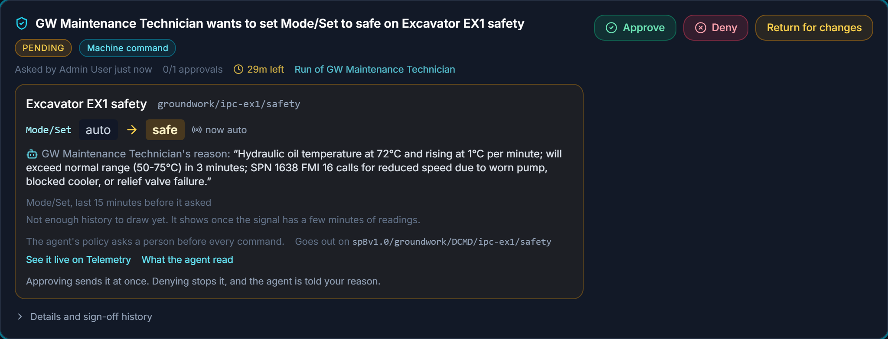</p>

Measured live, one run each:

| | HT1 off the road | EX1 pump wear |
|---|---|---|
| Fault to rule firing | under 1 s after HT1 crossed out | 5 min 15 s, the oil heating about 3 °C a minute, 64.5 °C against 55.7 °C |
| Agent reads the machine and decides | sent `Task/Assign {"do": "auto"}` | asked for `Mode/Set safe` 16 s after the firing, oil at 72 °C and rising |
| A person approves on /approvals | not needed, the risk tier let it through | 18 s |
| Approval to command at Abenix | | 119 ms |
| Abenix checks, then publish | 234 ms | 28 ms |
| The PC confirms | 330 ms | 80 ms |

A second EX1 run, through the ground station deployed in the cluster: the agent asked 19 s after the firing, a person approved 18 s later, the command reached Abenix 168 ms after the approval and was published after 136 ms of checks, and the PC confirmed it in 79 ms. Approval to publish varies run to run, 147 ms in the filmed run and 304 ms here.

The v1.1.1 film's run, on the NH108 layout: the rule fired 3 min 22 s after the wear started, 66.5 °C against 57.6 °C. The agent asked 25 s later, a person approved 27 s after that, the command reached Abenix 358 ms after the approval, was published after 127 ms of checks, and the PC confirmed it in 35 ms.

## Run it end to end

Plan on about an hour the first time, most of it Abenix building its images. Later starts take a few minutes.

### What you need

| | |
|---|---|
| Machine | 16 GB RAM, 4 CPUs, about 25 GB free disk |
| Docker Desktop or Docker Engine | Running, with at least 10 GB of memory. On Windows with WSL 2 see [Abenix local sizing](https://github.com/sarkar4777/abenix/blob/main/docs/06-deployment/09-local-sizing.md) |
| minikube, kubectl, Helm 3 | On your PATH |
| Git and bash | On Windows use Git Bash for every command below |
| Python 3.12 or later | `python --version` |
| Node 20 or later | `node --version` |
| A model for the agents | An Anthropic API key, or a Claude Pro or Max subscription signed in with Claude Code on this machine |

Without a model the site, the safety rules, the ML models and the dispatch loop all run. Only the agents wait. An OpenAI key is optional: with it the agents' knowledge search is semantic, without it the search matches keywords and says so.

### 1. Start Abenix

Groundwork needs Abenix 2.5.8 or later, for its telemetry, signal rules and governed commands. The core platform is enough, the other Abenix apps are not needed.

```bash
git clone https://github.com/sarkar4777/abenix.git
cd abenix
cp .env.example .env              # put ANTHROPIC_API_KEY=sk-ant-... here, or use the subscription below
APPS=none bash scripts/deploy.sh local
```

The first run builds every image, which takes 45 to 90 minutes. It ends with a list of URLs. Check it:

- http://localhost:3000 opens and you can sign in as `admin@abenix.dev` / `Admin123456`
- `curl http://localhost:8000/api/health` answers

**Subscription instead of a key:** sign in with Claude Code on this machine, then from the `abenix` folder run `bash scripts/sync-claude-subscription.sh`. The credential rotates. Run it again whenever agent runs fail with `OAuth access token has been revoked`.

**Port 3000 already taken:** deploy with `WEB_PORT=3100 bash scripts/deploy.sh local`, then use 3100 wherever this guide says 3000.

Leave Abenix running and open a second terminal.

### 2. Get Groundwork

```bash
git clone https://github.com/sarkar4777/groundwork.git
cd groundwork
python -m venv .venv
.venv/bin/pip install -r bff/requirements.txt         # Windows (Git Bash): .venv/Scripts/pip
(cd web && npm install)
cp .env.example .env
```

Open `.env` and set `ABENIX_ADMIN_PASSWORD=Admin123456`. If you moved the Abenix web port, set `ABENIX_WEB_URL` to match.

### 3. Load Groundwork into Abenix

```bash
.venv/bin/python scripts/provision.py                   # Windows (Git Bash): .venv/Scripts/python
```

It signs in once as the admin and mints this clone's own API key, named `groundwork-<host>-<folder>`, into `.env`. Another clone on the same Abenix gets its own key and keeps working. Then it loads, through the Abenix SDK:

- 3 code assets
- 4 decision tables
- 9 agents
- 7 pipelines
- 2 knowledge bases
- 4 Earned Autonomy action types

The safety rules are high risk, so publishing them needs sign-off in Abenix. In a workspace where you are the only admin, provisioning signs them itself with a recorded reason, and Abenix marks that as self-approved. If someone else in the workspace can approve, it names them and the rules wait in Abenix under **Approvals** until one of them signs, then run step 3 again to publish. The site holds a plan change while the crane limits are not yet in force.

It finishes by training the six ML models inside Abenix on data the twin generates. It ends with a table of everything it made and a link to each in the Abenix UI. It is safe to run again. It only changes what differs, and `--retrain` trains the models again.

### 4. Start the ground station

Pick one.

**A. Everything inside minikube.** Recommended on Windows, and what the film was recorded with.

```bash
bash scripts/deploy-k8s.sh             # builds the bff image into minikube and rolls it out next to Abenix
bash scripts/deploy-k8s.sh forward     # one port-forward to the bff on 8710, restarted by itself if it drops
(cd web && npm run dev)                # the ground station on 5710
```

`bash scripts/deploy-k8s.sh status` shows the bff, the forward and its health. `bash scripts/deploy-k8s.sh stop` ends the forward.

**B. The bff on your machine.**

```bash
bash scripts/dev.sh                    # bff on 8710 and web on 5710, Ctrl+C stops both
```

On Windows every twin step then crosses a `kubectl port-forward`, which adds about 44 ms to each request over about 6 KB. It still runs, at a lower step rate. Use A for smooth motion.

### 5. Open it

http://localhost:5710. The top bar should read **LIVE** with **Computed in Abenix**, and the latency strip fills within a few seconds.

## Use it

| Do this | To see |
|---|---|
| **Play the story** (top right, or **P**) | The 54 second day: a safety stop, a replan approved on a phone, a gust, the AI switched off, the whole ground station, an AI-written controller, Earned Autonomy |
| Fault deck: **Worker into swing zone** | The excavator stops in the same tick, the stop time in ms, then the Site Superintendent replans |
| Fault deck: **Cut CAN bus**, **Drop GNSS** | That machine's controllers and signal trace go quiet, and the Simplex switch puts it in safe mode |
| Fault deck: **Gust of wind** | The crane limits table holds the tower crane, the weather pipeline reshuffles the lifts |
| Fault deck: **Pull the AI** | Agents, models and pipelines stop. The site keeps running safely on its fallback plan |
| Fault deck: **Kill switch** | Sets the Abenix kill switch, which stops every Groundwork agent from inside Abenix |
| **1** to **5**, **X** | Drone feed, 3D twin, follow, crane cab, operator seat, and X for the nervous system |
| **O**, **H**, **Space**, **?** | Overlays on or off, hide the panels, pause the signal trace, help |
| Click a machine | Its inspector: position, load, joints and the controllers on its bus |
| Approvals | Plan changes wait in Abenix under **Approvals**. Approve there, or on the phone in the story |

Everything the site does is visible in Abenix too: runs in the Flight Recorder, the models under ML Models, the twin under Code Runner, the rules under Decisions.

## When something is wrong

| You see | Do this |
|---|---|
| `provision.py` says it cannot sign in | Check `ABENIX_URL` and `ABENIX_ADMIN_PASSWORD` in `.env`, and that http://localhost:3000 lets you sign in with them |
| `provision.py` fails at a step | Fix what it names and run it again. `--only models` reruns one step, the steps are `key,assets,decisions,agents,pipelines,kb,autonomy,models,rules,check` |
| `dev.sh` says Abenix is not answering | Start Abenix first. After any Abenix pod restarts, run `bash scripts/deploy.sh forwards` in the `abenix` folder |
| `dev.sh` says there is no ABENIX_API_KEY in .env | Run step 3 |
| The bff health says `401 Unauthorized` | The key in `.env` was revoked. Run step 3 again, then `bash scripts/deploy-k8s.sh` so the bff picks up the new key |
| The ground station says the bff is offline | `bash scripts/deploy-k8s.sh status`, then `bash scripts/deploy-k8s.sh forward` |
| Agent runs fail with `OAuth access token has been revoked` | Run `bash scripts/sync-claude-subscription.sh` in the `abenix` folder |
| Agent runs fail with an auth or key error | Add the key in Abenix under **Admin → Tool Configuration** (`ANTHROPIC_API_KEY`). It applies within 30 seconds |
| Agents say they matched the knowledge base by keywords | Abenix has no working OpenAI key. Add `OPENAI_API_KEY` under **Admin → Tool Configuration** for semantic search |
| L5 in the latency strip shows a dash | No agent has run yet. Play the story or use the fault deck |
| Motion is jerky on Windows | Use option A in step 4 |
| Pods pending or evicted in minikube | Docker is short of memory, see [Abenix local sizing](https://github.com/sarkar4777/abenix/blob/main/docs/06-deployment/09-local-sizing.md) |

## How it fits together

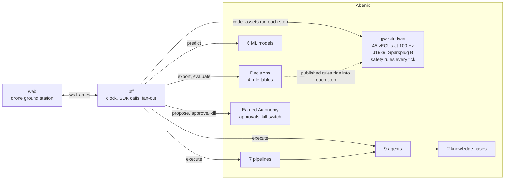

Groundwork is two thin pieces. The **web** draws the site. The **bff** holds the Abenix key, keeps the clock and fans frames out on `ws://localhost:8710/ws`. It talks to Abenix only through the Abenix Python SDK, vendored in `bff/vendor`. Everything that computes runs in Abenix:

| In Abenix | Groundwork's part |
|---|---|
| Code assets | `gw-site-twin` is the whole site: kinematics, terrain cut and fill, haul cycles, crane lifts with the load moment indicator, wind, the 45 vECUs and both bus protocols. `gw-dispatch-optimiser` assigns trucks. `gw-model-trainer` trains the models |
| Decisions | `gw.safety.exclusion`, `gw.crane.limits`, `gw.truck.speed`, `gw.simplex.switch`, published and versioned in Abenix and evaluated inside every twin tick |
| ML models | `gw-worker-path`, `gw-crane-collision`, `gw-hydraulic-anomaly`, `gw-payload`, `gw-gust-nowcast`, `gw-cycle-time`, trained in Abenix, served as ONNX |
| Pipelines | `gw-shift-start`, `gw-near-miss`, `gw-dispatch-loop`, `gw-fault-triage`, `gw-weather-hold`, `gw-end-of-shift`, `gw-train-models` |
| Agents | Site Superintendent, Safety Officer, Crane Coordinator, Fleet Dispatcher, Maintenance Technician, Earthworks Surveyor, Compliance Reporter, Foreman Voice, vECU Builder |
| Knowledge | `gw-site-safety-plan` and `gw-machine-manuals`, written in `abenix/kb/` |
| Governance | Earned Autonomy on `gw.plan.change`, `gw.truck.reroute`, `gw.crane.slew_plan`, `gw.machine.safe_mode`, approvals, the kill switch, lessons |

Details in [docs/architecture.md](docs/architecture.md), every signal in [docs/signals.md](docs/signals.md), the story in [docs/story.md](docs/story.md), the frame formats in [CONTRACT.md](CONTRACT.md).

## Inside Abenix

What the site looks like from the Abenix side.

| | |
|---|---|
| 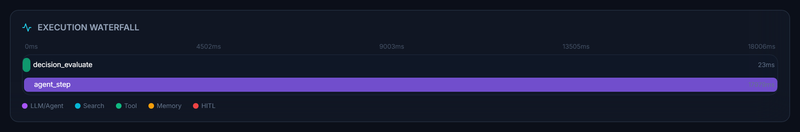 | 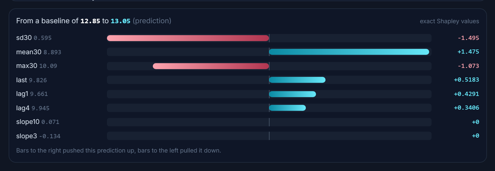 |
| Flight Recorder: a near-miss run, the rule check in 13 ms, then the Safety Officer | ML Models: why the gust nowcast predicted 13.05 m/s |
| 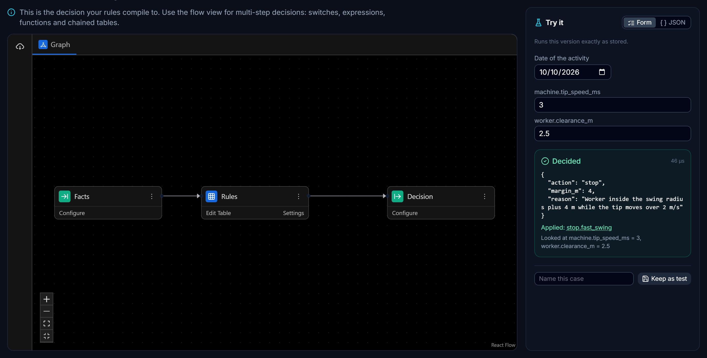 | 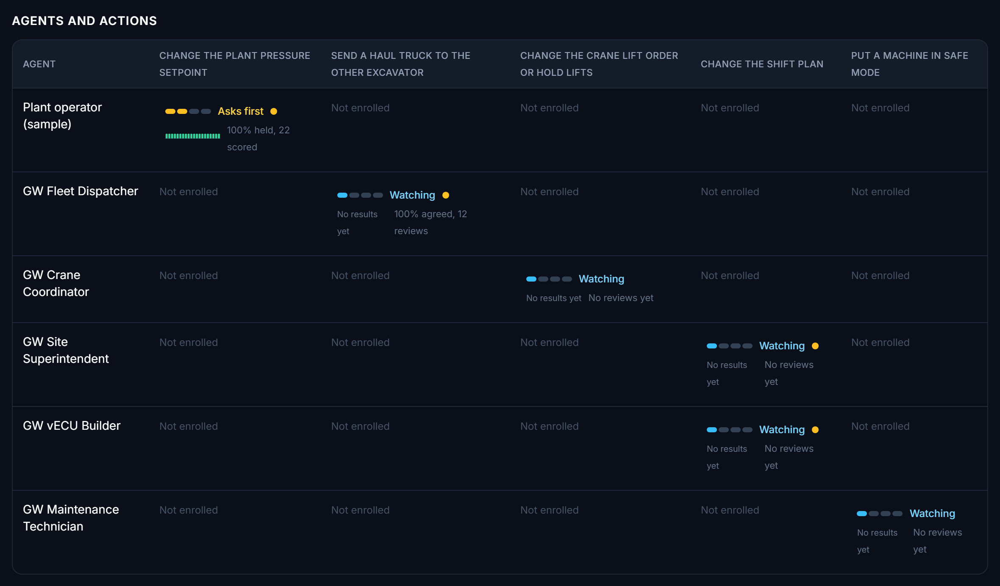 |
| Decisions: the exclusion rules decide stop in microseconds | Earned Autonomy: every Groundwork agent starts at Watching |

More in [docs/screenshots/abenix](docs/screenshots/abenix), and the ground station itself in [docs/screenshots](docs/screenshots).

## Honest notes

- **The bff is the metronome.** Abenix has no fixed-rate loop for code assets yet, so the bff calls the twin step. In the cluster it steps at a fixed 20 Hz with 5 controller ticks per step, so the controllers and safety rules run at 100 Hz of site time.
- **The safety rules are Abenix decision tables, evaluated inside the twin.** A decision API call per tick would cost more than the tick. The bff sends each published table into the twin when its version changes, the twin evaluates it every tick, and once a second the same facts go through `decisions.evaluate_batch` so the two can be compared live.
- **If Abenix is down, the site stops.** The twin runs in Abenix, so there is nothing to step. "AI offline" is different: no agent, model or pipeline is called, and the twin keeps running safely on its fallback plan.
- **The safety stop time is site time.** The stop event's `ms` is the time from the worker's tag sample arriving to the hold command in the same tick, plus the rule evaluation time.
- **Agents take seconds.** The Site Superintendent takes 15 to 20 s. Story mode replays a recorded real run so every take is identical, and says so on screen.
- **A stop on a PC is slower than a stop in the twin, and should be.** The twin decides in the same 10 ms tick, then the hold crosses Abenix and MQTT to the PC and the machine has to brake. Real sites keep the last line of defence on the machine: the PCs' own safety PLCs hold on a lost uplink or a stale setpoint without waiting for anyone.
- **The PCs run in real time, the twin follows.** In the industrial PC story the bff steps the twin by the wall clock rather than a fixed tick count, so site time and the PCs' time stay together.
- **Promotion is never faked.** Every Earned Autonomy grant starts at Watching. An agent only climbs when a person reviews its record and approves.

## Measured

On a laptop with Abenix on minikube.

| Layer | What | Number |
|---|---|---|
| L1 | Twin step, 5 ticks, compute | p50 2.2 ms, p99 4.1 ms |
| L1 | Twin step through the SDK into the warm runner, in the cluster | p50 17 ms |
| L2 | Four safety tables per 10 ms tick, in the twin | p99 0.50 ms |
| L2 | `decisions.evaluate_batch` through the SDK | p50 5 to 11 ms |
| L3 | ML predict through the SDK | p50 7 to 19 ms |
| L4 | Dispatch pipeline, model plus code asset | about 0.5 to 0.9 s |
| L5 | Site Superintendent run | 15 to 20 s |
| | Safety property test, 2,000 random worker paths | no worker reaches a moving swing radius without a stop first |

```bash
.venv/bin/python scripts/bench_twin.py local 1000     # the step's own compute
.venv/bin/python scripts/bench_twin.py abenix 300     # the real path through Abenix
.venv/bin/pip install -r bff/requirements-dev.txt && (cd bff && ../.venv/bin/python -m pytest -q)
```

## Layout

```
abenix/        what goes into Abenix: code-assets, agents, pipelines, decisions, kb, autonomy, models
bff/           the backend for the frontend, its tests and the vendored Abenix SDK
web/           the ground station
edge/          the industrial PCs: ECU containers, gateway, canbus sidecar, DBC and sample bus logs
deploy/k8s/    the bff and the PCs in minikube next to Abenix
scripts/       provision.py, dev.sh, deploy-k8s.sh, capture.mjs, capture-ipc.mjs, capture-abenix.mjs, bench_twin.py, record_story.py
docs/          architecture, signals, story, real imagery, brand, screenshots
data/          real imagery, tiles and reconstructions, fetched by script and never committed
```

## Licence

MIT, see [LICENSE](LICENSE). Third-party assets are CC0 and listed in [ASSETS.md](ASSETS.md). The vendored Abenix SDK is MIT.
