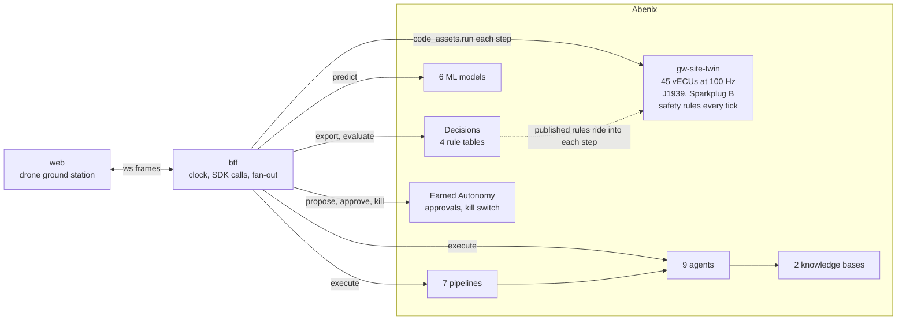

<p align="center"></p>

<p align="center"></p>

An autonomous construction site, run by [Abenix](https://github.com/sarkar4777/abenix). Northgate Yard is a fictional 4 hectare site digging the two-level basement of a 22-storey tower: two excavators, a dozer, six haul trucks, a luffing tower crane, a mobile crane, a piling rig, a roller, two survey drones and fourteen tagged workers. Every machine has its own virtual controllers talking J1939 on its own bus. Safety rules stop a machine in the same 10 ms tick a worker steps too close. Agents plan the day, a person approves the risky moves, and every number on screen is measured.

> The AI plans in seconds. The safety layer reacts in milliseconds. Abenix runs both, and you can watch every layer do its job.

Groundwork is a showcase, not certified safety software. Do not use it to run real machines.

**Contents:** [What is simulated](#what-is-simulated-and-how-to-swap-in-the-real-thing) · [Run it end to end](#run-it-end-to-end) · [Use it](#use-it) · [When something is wrong](#when-something-is-wrong) · [How it fits together](#how-it-fits-together) · [Inside Abenix](#inside-abenix) · [Honest notes](#honest-notes) · [Measured](#measured) · [Record the film](#record-the-film)

## What is simulated, and how to swap in the real thing

| Part | In Groundwork | The real thing |
|---|---|---|
| Drone imagery | A 3D twin of the site, rendered in the browser from CC0 aerial textures with lens, grain and a flight HUD | A live drone stream or an orthomosaic. Only the web's feed layer changes, every overlay reads the same site frame |
| Machine signals | 45 virtual ECUs run remotely inside Abenix as the code asset `gw-site-twin`, standing in for the industrial PCs on each machine. They tick at 100 Hz and emit bit-correct J1939 (EEC1, ET1, LFE1, VP, VDS, ETC2, CCVS1, HOURS, DM1 with BAM) and Sparkplug B | Real machines publish the same frames through a CAN or MQTT gateway |
| Telematics, GNSS, weather | Generated by the twin from a fixed seed, so a run can be replayed | ISO 15143-3 (AEMP 2.0) fleet feeds, RTK GNSS, a site weather station |
| Workers | Fourteen tagged workers walking realistic paths | UWB or BLE worker tags |

Everything that decides runs in Abenix whichever side of this table you are on: the safety rules, the ML models, the pipelines, the agents, approvals and the kill switch.

## Run it end to end

Plan on about an hour the first time, most of it Abenix building its images. Later starts take a few minutes.

### What you need

| | |
|---|---|
| Machine | 16 GB RAM, 4 CPUs, about 25 GB free disk |
| Docker Desktop or Docker Engine | Running, with at least 10 GB of memory. On Windows with WSL 2 see [Abenix local sizing](https://github.com/sarkar4777/abenix/blob/main/docs/06-deployment/09-local-sizing.md) |
| minikube, kubectl, Helm 3 | On your PATH |
| Git and bash | On Windows use Git Bash for every command below |
| Python 3.12 or later | `python --version` |
| Node 20 or later | `node --version` |
| A model for the agents | An Anthropic API key, or a Claude Pro or Max subscription signed in with Claude Code on this machine |

Without a model the site, the safety rules, the ML models and the dispatch loop all run. Only the agents wait. An OpenAI key is optional: with it the agents' knowledge search is semantic, without it the search matches keywords and says so.

### 1. Start Abenix

Groundwork needs Abenix 2.5.6 or later. The core platform is enough, the other Abenix apps are not needed.

```bash
git clone https://github.com/sarkar4777/abenix.git
cd abenix
cp .env.example .env              # put ANTHROPIC_API_KEY=sk-ant-... here, or use the subscription below
APPS=none bash scripts/deploy.sh local
```

The first run builds every image, which takes 45 to 90 minutes. It ends with a list of URLs. Check it:

- http://localhost:3000 opens and you can sign in as `admin@abenix.dev` / `Admin123456`
- `curl http://localhost:8000/api/health` answers

**Subscription instead of a key:** sign in with Claude Code on this machine, then from the `abenix` folder run `bash scripts/sync-claude-subscription.sh`. The credential rotates. Run it again whenever agent runs fail with `OAuth access token has been revoked`.

**Port 3000 already taken:** deploy with `WEB_PORT=3100 bash scripts/deploy.sh local`, then use 3100 wherever this guide says 3000.

Leave Abenix running and open a second terminal.

### 2. Get Groundwork

```bash
git clone https://github.com/sarkar4777/groundwork.git
cd groundwork
python -m venv .venv
.venv/bin/pip install -r bff/requirements.txt         # Windows (Git Bash): .venv/Scripts/pip
(cd web && npm install)
cp .env.example .env
```

Open `.env` and set `ABENIX_ADMIN_PASSWORD=Admin123456`. If you moved the Abenix web port, set `ABENIX_WEB_URL` to match.

### 3. Load Groundwork into Abenix

```bash
.venv/bin/python scripts/provision.py                   # Windows (Git Bash): .venv/Scripts/python
```

It signs in once as the admin and mints an API key named `groundwork` into `.env`. Then it loads, through the Abenix SDK:

- 3 code assets
- 4 decision tables
- 9 agents
- 7 pipelines
- 2 knowledge bases
- 4 Earned Autonomy action types

It finishes by training the six ML models inside Abenix on data the twin generates. It ends with a table of everything it made and a link to each in the Abenix UI. It is safe to run again. It only changes what differs, and `--retrain` trains the models again.

### 4. Start the ground station

Pick one.

**A. Everything inside minikube.** Recommended on Windows, and what the film was recorded with.

```bash
bash scripts/deploy-k8s.sh             # builds the bff image into minikube and rolls it out next to Abenix
bash scripts/deploy-k8s.sh forward     # one port-forward to the bff on 8710, restarted by itself if it drops
(cd web && npm run dev)                # the ground station on 5710
```

`bash scripts/deploy-k8s.sh status` shows the bff, the forward and its health. `bash scripts/deploy-k8s.sh stop` ends the forward.

**B. The bff on your machine.**

```bash
bash scripts/dev.sh                    # bff on 8710 and web on 5710, Ctrl+C stops both
```

On Windows every twin step then crosses a `kubectl port-forward`, which adds about 44 ms to each request over about 6 KB. It still runs, at a lower step rate. Use A for smooth motion.

### 5. Open it

http://localhost:5710. The top bar should read **LIVE** with **Computed in Abenix**, and the latency strip fills within a few seconds.

## Use it

| Do this | To see |
|---|---|
| **Play the story** (top right, or **P**) | The 54 second day: a safety stop, a replan approved on a phone, a gust, the AI switched off, the whole ground station, an AI-written controller, Earned Autonomy |
| Fault deck: **Worker into swing zone** | The excavator stops in the same tick, the stop time in ms, then the Site Superintendent replans |
| Fault deck: **Cut CAN bus**, **Drop GNSS** | That machine's controllers and signal trace go quiet, and the Simplex switch puts it in safe mode |
| Fault deck: **Gust of wind** | The crane limits table holds the tower crane, the weather pipeline reshuffles the lifts |
| Fault deck: **Pull the AI** | Agents, models and pipelines stop. The site keeps running safely on its fallback plan |
| Fault deck: **Kill switch** | Sets the Abenix kill switch, which stops every Groundwork agent from inside Abenix |
| **1** to **5**, **X** | Drone feed, 3D twin, follow, crane cab, operator seat, and X for the nervous system |
| **O**, **H**, **Space**, **?** | Overlays on or off, hide the panels, pause the signal trace, help |
| Click a machine | Its inspector: position, load, joints and the controllers on its bus |
| Approvals | Plan changes wait in Abenix under **Approvals**. Approve there, or on the phone in the story |

Everything the site does is visible in Abenix too: runs in the Flight Recorder, the models under ML Models, the twin under Code Runner, the rules under Decisions.

## When something is wrong

| You see | Do this |
|---|---|
| `provision.py` says it cannot sign in | Check `ABENIX_URL` and `ABENIX_ADMIN_PASSWORD` in `.env`, and that http://localhost:3000 lets you sign in with them |
| `provision.py` fails at a step | Fix what it names and run it again. `--only models` reruns one step, the steps are `key,assets,decisions,agents,pipelines,kb,autonomy,models,check` |
| `dev.sh` says Abenix is not answering | Start Abenix first. After any Abenix pod restarts, run `bash scripts/deploy.sh forwards` in the `abenix` folder |
| `dev.sh` says there is no ABENIX_API_KEY in .env | Run step 3 |
| The ground station says the bff is offline | `bash scripts/deploy-k8s.sh status`, then `bash scripts/deploy-k8s.sh forward` |
| Agent runs fail with `OAuth access token has been revoked` | Run `bash scripts/sync-claude-subscription.sh` in the `abenix` folder |
| Agent runs fail with an auth or key error | Add the key in Abenix under **Admin → Tool Configuration** (`ANTHROPIC_API_KEY`). It applies within 30 seconds |
| Agents say they matched the knowledge base by keywords | Abenix has no working OpenAI key. Add `OPENAI_API_KEY` under **Admin → Tool Configuration** for semantic search |
| L5 in the latency strip shows a dash | No agent has run yet. Play the story or use the fault deck |
| Motion is jerky on Windows | Use option A in step 4 |
| Pods pending or evicted in minikube | Docker is short of memory, see [Abenix local sizing](https://github.com/sarkar4777/abenix/blob/main/docs/06-deployment/09-local-sizing.md) |

## How it fits together



Groundwork is two thin pieces. The **web** draws the site. The **bff** holds the Abenix key, keeps the clock and fans frames out on `ws://localhost:8710/ws`. It talks to Abenix only through the Abenix Python SDK, vendored in `bff/vendor`. Everything that computes runs in Abenix:

| In Abenix | Groundwork's part |
|---|---|
| Code assets | `gw-site-twin` is the whole site: kinematics, terrain cut and fill, haul cycles, crane lifts with the load moment indicator, wind, the 45 vECUs and both bus protocols. `gw-dispatch-optimiser` assigns trucks. `gw-model-trainer` trains the models |
| Decisions | `gw.safety.exclusion`, `gw.crane.limits`, `gw.truck.speed`, `gw.simplex.switch`, published and versioned in Abenix and evaluated inside every twin tick |
| ML models | `gw-worker-path`, `gw-crane-collision`, `gw-hydraulic-anomaly`, `gw-payload`, `gw-gust-nowcast`, `gw-cycle-time`, trained in Abenix, served as ONNX |
| Pipelines | `gw-shift-start`, `gw-near-miss`, `gw-dispatch-loop`, `gw-fault-triage`, `gw-weather-hold`, `gw-end-of-shift`, `gw-train-models` |
| Agents | Site Superintendent, Safety Officer, Crane Coordinator, Fleet Dispatcher, Maintenance Technician, Earthworks Surveyor, Compliance Reporter, Foreman Voice, vECU Builder |
| Knowledge | `gw-site-safety-plan` and `gw-machine-manuals`, written in `abenix/kb/` |
| Governance | Earned Autonomy on `gw.plan.change`, `gw.truck.reroute`, `gw.crane.slew_plan`, `gw.machine.safe_mode`, approvals, the kill switch, lessons |

Details in [docs/architecture.md](docs/architecture.md), every signal in [docs/signals.md](docs/signals.md), the story in [docs/story.md](docs/story.md), the frame formats in [CONTRACT.md](CONTRACT.md).

## Inside Abenix

What the site looks like from the Abenix side, captured with `scripts/capture-abenix.mjs`.

| | |
|---|---|
|  |  |
| Flight Recorder: a near-miss run, the rule check in 13 ms, then the Safety Officer | ML Models: why the gust nowcast predicted 13.05 m/s |
|  |  |
| Decisions: the exclusion rules decide stop in microseconds | Earned Autonomy: every Groundwork agent starts at Watching |

More in [docs/screenshots/abenix](docs/screenshots/abenix), and the ground station itself in [docs/screenshots](docs/screenshots).

## Honest notes

- **The bff is the metronome.** Abenix has no fixed-rate loop for code assets yet, so the bff calls the twin step. In the cluster it steps at a fixed 20 Hz with 5 controller ticks per step, so the controllers and safety rules run at 100 Hz of site time.
- **The safety rules are Abenix decision tables, evaluated inside the twin.** A decision API call per tick would cost more than the tick. The bff sends each published table into the twin when its version changes, the twin evaluates it every tick, and once a second the same facts go through `decisions.evaluate_batch` so the two can be compared live.
- **If Abenix is down, the site stops.** The twin runs in Abenix, so there is nothing to step. "AI offline" is different: no agent, model or pipeline is called, and the twin keeps running safely on its fallback plan.
- **The safety stop time is site time.** The stop event's `ms` is the time from the worker's tag sample arriving to the hold command in the same tick, plus the rule evaluation time.
- **Agents take seconds.** The Site Superintendent takes 15 to 20 s. Story mode replays a recorded real run so every take is identical, and says so on screen.
- **Promotion is never faked.** Every Earned Autonomy grant starts at Watching. An agent only climbs when a person reviews its record and approves.

## Measured

On a laptop with Abenix on minikube.

| Layer | What | Number |
|---|---|---|
| L1 | Twin step, 5 ticks, compute | p50 2.2 ms, p99 4.1 ms |
| L1 | Twin step through the SDK into the warm runner, in the cluster | p50 17 ms |
| L2 | Four safety tables per 10 ms tick, in the twin | p99 0.50 ms |
| L2 | `decisions.evaluate_batch` through the SDK | p50 5 to 11 ms |
| L3 | ML predict through the SDK | p50 7 to 19 ms |
| L4 | Dispatch pipeline, model plus code asset | about 0.5 to 0.9 s |
| L5 | Site Superintendent run | 15 to 20 s |
| | Safety property test, 2,000 random worker paths | no worker reaches a moving swing radius without a stop first |

```bash
.venv/bin/python scripts/bench_twin.py local 1000     # the step's own compute
.venv/bin/python scripts/bench_twin.py abenix 300     # the real path through Abenix
.venv/bin/pip install -r bff/requirements-dev.txt && (cd bff && ../.venv/bin/python -m pytest -q)
```

## What building this fixed in Abenix

Groundwork uses Abenix only through its public API and SDK. Where that fell short it was fixed in Abenix, not worked around here. All of these shipped in Abenix 2.5.6:

- **Code asset step time:** `code_asset` re-checked its schemas on every call. A twin step went from 66 ms to 17 ms.
- **Large inputs:** code asset runs on a Kubernetes Job now receive their input as files, so a 430 KB training set runs.
- **Cold first call:** a new code asset version starts its warm runner on upload. The first call went from 151 s to under 5 s.
- **Concurrency slots:** tool concurrency slots are leases, so a cancelled call no longer leaves the tool answering 429.
- **Approval waits:** approval long-polls give their database connection back between reads.
- **SDK retries:** the SDK waits retry a busy server.
- **Agent step output:** pipeline agent steps pass on the JSON their output schema describes.
- **Kill switch:** the kill switch stops the very next run.
- **SDK coverage:** ML predict and upload, code asset run and versions, autonomy enrol, model listing and API keys are all in the SDK.

## Record the film

```bash
(cd web && npx playwright install chromium)      # once
node scripts/capture.mjs                         # both films, 1920x1080 and 1080x1350, with subtitles, into docs/media
ABENIX_WEB_URL=http://localhost:3000 ABENIX_ADMIN_EMAIL=admin@abenix.dev ABENIX_ADMIN_PASSWORD=Admin123456 \
  node scripts/capture-abenix.mjs                # the Abenix screenshots
```

The films are cut from a live run against Abenix, so start the ground station first.

## Layout

```
abenix/        what goes into Abenix: code-assets, agents, pipelines, decisions, kb, autonomy, models
bff/           the backend for the frontend, its tests and the vendored Abenix SDK
web/           the ground station
deploy/k8s/    the bff in minikube next to Abenix
scripts/       provision.py, dev.sh, deploy-k8s.sh, capture.mjs, capture-abenix.mjs, bench_twin.py, record_story.py
docs/          architecture, signals, story, brand, screenshots
```

## Licence

MIT, see [LICENSE](LICENSE). Third-party assets are CC0 and listed in [ASSETS.md](ASSETS.md). The vendored Abenix SDK is MIT.
