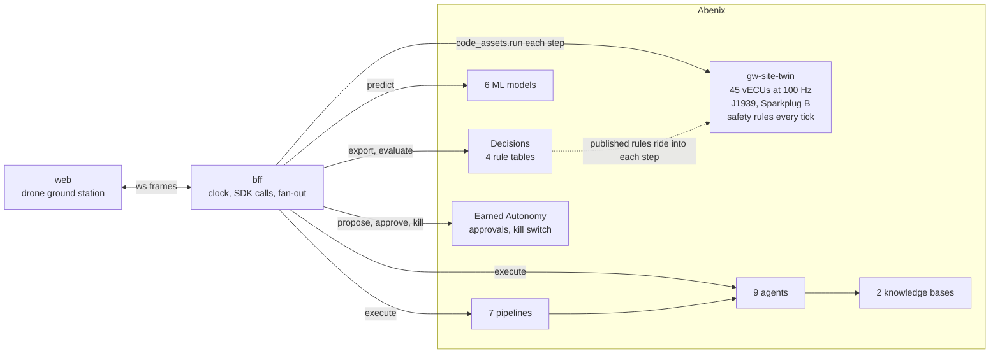

# Groundwork

An autonomous construction site, run by Abenix. Northgate Yard is a fictional 4 hectare site digging the two-level basement of a 22-storey tower: two excavators, a dozer, six haul trucks, a luffing tower crane, a mobile crane, a piling rig, a roller, two survey drones and fourteen tagged workers. Every machine has its own virtual controllers talking J1939 on its own bus. Safety rules stop machines in the same 10 ms tick a worker steps too close. Agents plan the day, a person approves the risky moves, and every number on screen is measured.

> The AI plans in seconds. The safety layer reacts in milliseconds. Abenix runs both, and you can watch every layer do its job.

Groundwork is a showcase, not certified safety software. Do not use it to run real machines.

## Quick start, 5 minutes

You need a running Abenix (2.5.6 or later) with an admin account, Python 3.12 or later and Node 20.

```bash
git clone <this repo> groundwork && cd groundwork
python -m venv .venv
.venv/bin/pip install -r bff/requirements.txt          # Windows: .venv\Scripts\pip
(cd web && npm install)

# load the twin, agents, rules, pipelines, knowledge and models into Abenix,
# mint the groundwork API key into .env, and train the six models in Abenix
ABENIX_URL=http://localhost:8000 ABENIX_ADMIN_EMAIL=admin@abenix.dev ABENIX_ADMIN_PASSWORD=... \
  .venv/bin/python scripts/provision.py

bash scripts/dev.sh                                     # bff on 8710, web on 5710
```

Open http://localhost:5710. Press X for the nervous system view. The fault deck cuts a CAN bus, drops GNSS, sends a gust, walks a worker into a swing zone, pulls the AI or hits the kill switch. Play the story runs the 60 second day.

`provision.py` is idempotent. Run it again after changing anything in `abenix/`. It prints a link to everything it made in the Abenix UI (set `ABENIX_WEB_URL` if the UI is not on port 3000).

## How it fits together



Groundwork is two thin pieces. The **web** draws the site. The **bff** holds the Abenix key, keeps the clock and fans frames out on `ws://localhost:8710/ws`. Everything that computes runs in Abenix:

| In Abenix | Groundwork's part |
|---|---|
| Code assets | `gw-site-twin` is the whole site: kinematics, terrain cut and fill, haul cycles, crane lifts with the load moment indicator, wind, 45 vECUs ticking at 100 Hz, bit-correct J1939 (EEC1, ET1, LFE1, VP, VDS, ETC2, CCVS1, HOURS, DM1 with BAM transport) and Sparkplug B. `gw-dispatch-optimiser` assigns trucks. `gw-model-trainer` trains the models |
| Decisions | `gw.safety.exclusion`, `gw.crane.limits`, `gw.truck.speed`, `gw.simplex.switch`, published and versioned in Abenix and evaluated inside every twin tick |
| ML models | `gw-worker-path`, `gw-crane-collision`, `gw-hydraulic-anomaly`, `gw-payload`, `gw-gust-nowcast`, `gw-cycle-time`, trained in Abenix on data the twin generates, served as ONNX |
| Pipelines | `gw-shift-start`, `gw-near-miss`, `gw-dispatch-loop`, `gw-fault-triage`, `gw-weather-hold`, `gw-end-of-shift`, `gw-train-models` |
| Agents | Site Superintendent, Safety Officer, Crane Coordinator, Fleet Dispatcher, Maintenance Technician, Earthworks Surveyor, Compliance Reporter, Foreman Voice, vECU Builder |
| Knowledge | `gw-site-safety-plan` and `gw-machine-manuals`, written in `abenix/kb/` |
| Governance | Earned Autonomy on `gw.plan.change`, `gw.truck.reroute`, `gw.crane.slew_plan`, `gw.machine.safe_mode`, approvals, the kill switch, lessons |

Details in [docs/architecture.md](docs/architecture.md), every signal in [docs/signals.md](docs/signals.md), the story in [docs/story.md](docs/story.md), the frame formats in [CONTRACT.md](CONTRACT.md).

## Honest notes

- **The bff is the metronome.** Abenix has no fixed-rate loop yet, so the bff calls the twin step as fast as Abenix answers. Each step runs as many 10 ms controller ticks as wall time has passed, so the controllers and safety rules run at 100 Hz of site time. Abenix 2.5.6 is adding a fixed-rate runner for code assets. When it lands the loop moves into Abenix and nothing else changes.
- **The safety rules are Abenix decision tables, evaluated inside the twin.** A decision API call per tick would cost more than the tick. The bff sends each published table into the twin when its version changes, the twin evaluates it every tick, and once a second the same facts go through `decisions.evaluate_batch` so the two can be compared live.
- **If Abenix is down, the site stops.** The twin runs in Abenix, so there is nothing to step. "AI offline" is different: no agent, model or pipeline is called, and the twin keeps running safely on its fallback plan.
- **The safety stop time is site time.** The stop event's `ms` is the time from the worker's tag sample arriving to the hold command in the same tick, plus the rule evaluation time.
- **Agents take seconds.** The superintendent takes 15 to 20 s on a laptop. Story mode replays a recorded real run so takes are identical, and says so on screen.
- **Promotion is never faked.** Every Earned Autonomy grant starts at Watching. The Dispatcher only climbs when a person reviews its record and approves.

## Measured

On a laptop with Abenix on local Kubernetes (minikube). Re-run them with the commands below.

| Layer | What | Number |
|---|---|---|
| L1 | Twin step, 5 ticks, compute | p50 2.2 ms, p99 4.1 ms, 0.8 ms per tick |
| L1 | Twin step through the SDK into the warm runner, 16 KB in, 26 KB out | from a Windows host through port-forward p50 64 ms, p99 183 ms, 15 steps a second; inside the cluster p50 17 ms |
| L2 | Four safety tables per 10 ms tick, in the twin | p99 0.50 ms |
| L2 | `decisions.evaluate_batch` through the SDK | p50 11 ms |
| L3 | ML predict through the SDK | p50 12 to 19 ms |
| L4 | Dispatch pipeline (model plus code asset) | about 0.6 to 0.9 s |
| L4 | Pipeline with an agent step | 15 to 30 s |
| L5 | Site Superintendent run | 15 to 20 s |
| | Safety property test, 2,000 random worker paths | no worker reaches a moving swing radius without a stop first |

```bash
.venv/bin/python scripts/bench_twin.py local 1000     # the step's own compute
.venv/bin/python scripts/bench_twin.py abenix 300     # the real path through Abenix
cd bff && ../.venv/bin/python -m pytest -q           # 49 tests, GW_SAFETY_PATHS sets the path count
```

## Platform gaps this found

Groundwork talks to Abenix only through the public API and the SDK. Where that was missing or slow it was reported to Abenix as a fix, not worked around here:

| Gap | Measured | Status |
|---|---|---|
| `code_asset` validated its schemas against the metaschema on every call | twin step p50 66 ms around a 2.5 ms run | fixed in 2.5.6, in-cluster p50 17 ms |
| Request bodies over about 6 KB stall about 44 ms through `kubectl port-forward` on Windows | decision evaluate 4 KB 3 ms, 8 KB 48 ms; inside the cluster 15 KB 1.5 ms | not Abenix. Run the bff in the cluster, see below |
| No fixed-rate execution of a code asset | the bff has to be the metronome | planned for 2.5.6 |
| First call after a new code asset version | 151 s on the Job path, now 0.02 to 5 s warm | fixed in 2.5.6, prewarm on upload |
| Job path passes the input in an environment variable | a 430 KB training input fails with exit 255 when no warm runner is up | reported |
| Tool gate concurrency slots leaked on cancelled calls | 429 with one or two calls in flight | fixed in 2.5.6, slots are leases |
| Pipeline agent steps ignored the agent's output schema | prose with fenced JSON | fixed in 2.5.6 |
| Agent-scope kill switch by id not enforced on API key runs | agent ran to completion with the switch set, pipelines stop as expected | reported |
| SDK lacked ML predict and upload, code asset run, create and versions, kill switches, API keys, decision test update | | added in 2.5.6 and used here |
| No SDK method for autonomy enrol or LLM model listing | provision and the bff use the HTTP API for these | reported |

## Run the bff inside the cluster

On Windows, `kubectl port-forward` adds about 44 ms to every request body over about 6 KB, and every twin step sends 16 KB. The browser channel only receives, so it does not pay this. For the showcase run the bff next to Abenix:

```bash
MINIKUBE_PROFILE=minikube bash scripts/deploy-k8s.sh           # build, apply, roll out
MINIKUBE_PROFILE=minikube bash scripts/deploy-k8s.sh forward   # the one port-forward, in the background with a pid file
# bash scripts/deploy-k8s.sh stop ends it, status shows the deployment, the forward and the bff health
(cd web && npm run dev)
```

In the cluster the bff steps at a fixed 20 Hz with 5 ticks per step (`GW_FIXED_TICKS=5`), so site time is wall time. On a laptop path with the stall, the bff falls back to as many ticks per step as wall time needs. For Story mode from a laptop set `GW_STORY_TICKS=8` so 60 s of story stays near 60 s of wall time.

## Screenshots

The web half captures these from Story mode with `node scripts/capture.mjs`. They live in [docs/screenshots](docs/screenshots).

| | |
|---|---|
| Hero shot | `docs/screenshots/01-hero.png` |
| Nervous system view | `docs/screenshots/02-nervous-system.png` |
| Safety stop | `docs/screenshots/03-safety-stop.png` |
| Site Pilot mid-replan | `docs/screenshots/04-site-pilot-replan.png` |
| Phone approval | `docs/screenshots/05-phone-approval.png` |
| Signal trace | `docs/screenshots/06-signal-trace.png` |
| Crane cab | `docs/screenshots/07-crane-cab.png` |
| Earned Autonomy | `docs/screenshots/08-earned-autonomy.png` |
| Abenix agents page | to capture from Abenix |
| Latency strip | `docs/screenshots/10-latency-strip.png` |

## Layout

```
abenix/        what goes into Abenix: code-assets, agents, pipelines, decisions, kb, autonomy, specs
bff/           the backend for the frontend, its tests and the vendored Abenix SDK
web/           the ground station
scripts/       provision.py, dev.sh, record_story.py, bench_twin.py, capture.mjs
docs/          architecture, signals, story, screenshots
```

## Licence

MIT, see [LICENSE](LICENSE). Third-party assets are CC0 and listed in [ASSETS.md](ASSETS.md). The vendored Abenix SDK is MIT.
